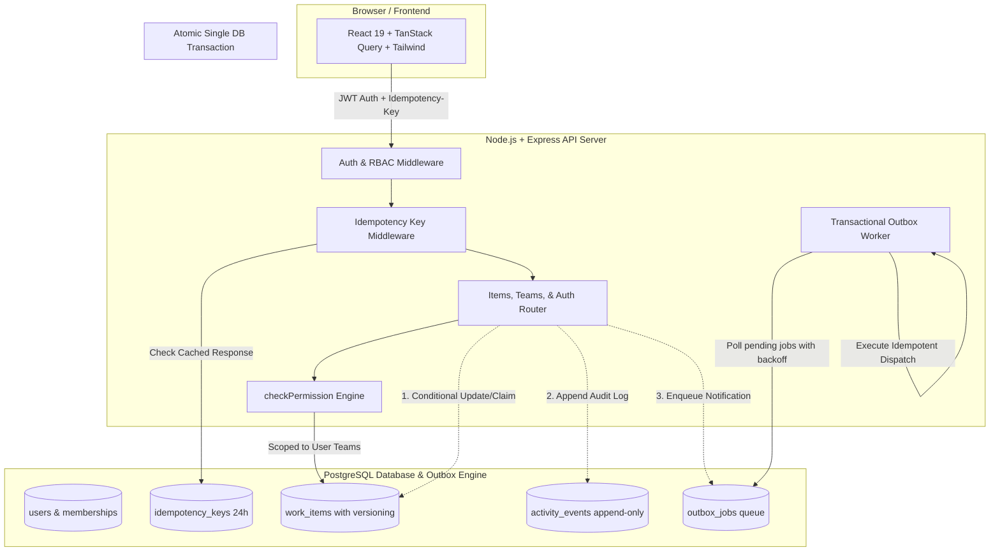

# Newtonite — Operations Under Pressure

Newtonite is an internal operations coordination platform engineered to replace chaotic chat and spreadsheets during high-pressure incidents.
It guarantees state integrity through atomic single-writer claiming, optimistic concurrency locking, and server-enforced resource permissions.
Every mutation writes to an immutable append-only activity ledger and a transactional outbox queue with exponential retry backoff.

---

## Architecture Diagram



---

## 5 Critical Concurrency & Reliability Behaviors

1. **Concurrent Claim (`POST /items/:id/claim`)**:
   Atomic SQL condition: `UPDATE work_items SET assignee_id=$userId, version=version+1 WHERE id=$id AND assignee_id IS NULL`. When two operators attempt to claim the same incident simultaneously, the database guarantees exactly one succeeds (`200 OK`) and the other receives `409 Conflict`.
2. **Stale Update / Optimistic Locking (`PATCH /items/:id`)**:
   Client sends the item's integer `version`. The update executes `WHERE id=$id AND version=$clientVersion`. If another operator updated the record in the interim, `rowCount === 0` and the API returns `409 Conflict` along with the latest database record.
3. **Idempotency (`Idempotency-Key` header)**:
   All item creations support the `Idempotency-Key` header. Responses are persisted in `idempotency_keys` for 24 hours. Replay requests return the original response without duplicating records.
4. **Resource-Level Authorization (Information Leak Protection)**:
   Every request checks if the authenticated operator is a member of the item's team. If not, the server returns `404 Not Found` (never `403`) to avoid disclosing whether private team records exist.
5. **Reliable Async Jobs + Activity Ledger (Transactional Outbox)**:
   Every state change records an append-only row in `activity_events` and an outbox task in `outbox_jobs` in the **exact same database transaction**. An asynchronous background worker retries failed jobs with exponential backoff up to 5 attempts, with idempotent notification dispatchers.

---

## Prerequisites

- **Node.js**: v20 or v22+
- **Docker & Docker Compose**: (v2.20+) for containerized deployment
- **npm**: v10+

---

## Quickstart with Docker Compose

Run the entire stack (Express API + Vite Frontend + PostgreSQL + Redis) with a single command:

```bash
docker compose up --build
```

The application will be live at: **http://localhost:3000**

---

## Database Seeding (3,000 Records)

To seed the 4 operational teams, 10 role-based users, and 3,000 realistic work items demonstrating index-backed cursor pagination:

```bash
# In local development:
npm run seed

# Inside Docker Compose:
docker compose exec app npm run seed
```

---

## Demo Credentials & Persona Logins

All demo accounts share the password: `password123`

| Role | Name | Email | Scoped Teams & Permissions |
| :--- | :--- | :--- | :--- |
| **Admin** | Alex Vance | `alex.admin@newtonite.internal` | All 4 teams. Full operational & administrative privileges. |
| **Lead** | Sarah Chen | `sarah.lead@newtonite.internal` | Core Infrastructure & SRE. Can approve (`AwaitingApproval` -> `Resolved`) and reassign operators. |
| **Member** | Dave Miller | `dave.member@newtonite.internal` | Core Infrastructure & Payments. Can create, edit, claim, and comment. |
| **Viewer** | Sam Taylor | `sam.viewer@newtonite.internal` | Core Infrastructure & Payments. Read-only audit access. Mutating actions rejected. |

*(Note: The UI also provides a 1-click persona switcher in the header and login screen).*

---

## Running the Automated Test Suite

Newtonite includes a comprehensive Vitest + Supertest suite validating all 5 critical concurrency behaviors:

```bash
# Run tests locally:
npm test

# Inside Docker:
docker compose exec app npm test
```

### Verified Test Suite:
- `✓ 1. CONCURRENT CLAIM: exactly one operator claims unassigned item when fired in parallel`
- `✓ 2. STALE UPDATE: update with old version rejected with 409 and latest item payload`
- `✓ 3. IDEMPOTENCY: identical Idempotency-Key header returns stored response and creates only one item`
- `✓ 4. RESOURCE-LEVEL AUTHORIZATION: user outside item team gets 404 (not 403)`
- `✓ 5. RELIABLE ASYNC JOBS + ACTIVITY LOG: transactional atomicity, idempotency, and retry backoff`

---

## Known Limitations

1. **Cursor Pagination Traversal**: Keyset pagination orders by `(created_at DESC, id DESC)`. While optimal for preventing page drift and maintaining $O(\log N)$ performance, it does not support arbitrary page jumping (e.g. "Jump directly to page 42").
2. **Outbox Polling Latency**: The built-in worker polls for pending outbox jobs every 2 seconds. In production environments requiring sub-second dispatch, PostgreSQL `LISTEN / NOTIFY` or BullMQ with Redis pub/sub can be enabled to trigger workers instantly upon transaction commit.
3. **Idempotency Key Scope**: Current idempotency keys are scoped globally per key string. In multi-tenant environments with overlapping client-generated UUIDs, scoping keys by `(tenant_id, user_id, key)` is recommended.
4. **Full-Text Search Lexing**: Search currently utilizes PostgreSQL `ILIKE` across titles and descriptions with composite indexes. For multi-language fuzzy matching, PostgreSQL `tsvector` with GIN indexes or OpenSearch can be added.
